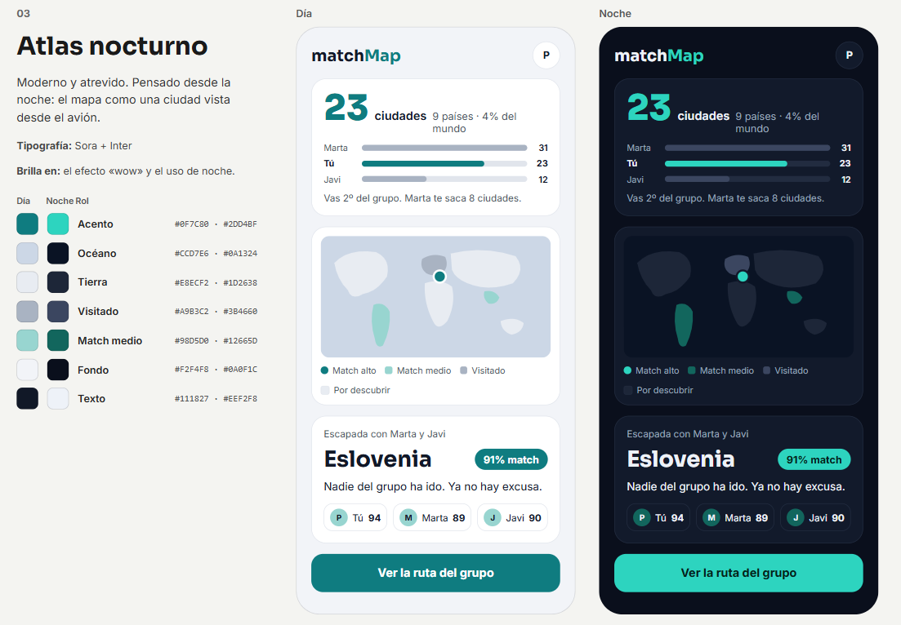

# MatchMap


Web and native mobile app for **MatchMap**, a travel app where people pin the countries and cities they have **visited**, **want to visit** or have **lived in**, see them on a world map, and compare their map with friends: places in common, places only one of them knows, a shared wishlist, trip ideas, and a compatibility score.

This repository contains the clients only: a web app and a mobile app written in Angular, sharing their business logic through `packages/shared`. The API lives in [pcolina/matchMap-api](https://github.com/pcolina/matchMap-api) and is consumed exclusively through its GraphQL contract.

> **Status:** MVP under active development. It runs locally; nothing is deployed or published to a store. See [Roadmap](#roadmap) for what works today and what comes next.

---

## Table of contents

- [Features](#features)
- [Tech stack](#tech-stack)
- [Architecture](#architecture)
- [Getting started](#getting-started)
- [Development](#development)
- [Design system](#design-system)
- [How this project is built](#how-this-project-is-built)
- [Project layout](#project-layout)
- [Configuration](#configuration)
- [Roadmap](#roadmap)
- [Pending decisions](#pending-decisions)

---

## Features

Available today:

- **Monorepo scaffold** with pnpm workspaces: one lockfile and one `node_modules` at the root, shared by both apps.
- **Web app** shell in Angular, built as a static site.
- **Mobile app** shell in Angular rendered as native iOS and Android views with ng-native on Expo.
- **Shared package** (`@matchmap/shared`) for code that draws nothing on screen.
- **Design system**: colour, type, spacing and motion tokens in one source file (`tokens/tokens.json`), with day and night palettes and a WCAG contrast report.
- **Brand kit**: logo symbol and lockups, app and store icons, favicons.

Planned: user accounts and sign-in, profile, pins on the world map, friends, map comparison, trip ideas and the compatibility score. See [Roadmap](#roadmap).

## Tech stack

| Area | Technology |
|---|---|
| Web | Angular 22 (Angular CLI), signals, zoneless, static build |
| Mobile | [ng-native](https://ng-native.com) 0.14: Angular rendered as native views. It runs on the Expo SDK 57 and React Native 0.86 runtime that ng-native requires, as a development build |
| Shared code | TypeScript package `@matchmap/shared` |
| State | `@ngrx/signals` (SignalStore), one store per feature |
| Async streams | RxJS, bridged into stores with `rxMethod` |
| Routing | `@angular/router` (web), `@ng-native/router` (mobile) |
| Forms | Signal Forms (web and mobile) |
| Secure storage | `expo-secure-store` for the refresh token (mobile) |
| Icons | Lucide through `@ng-icons/lucide` (web and mobile, see [`docs/design.md`](docs/design.md) §5) |
| Lint and format | ESLint and Prettier |
| GraphQL client | Apollo (`apollo-angular`) |
| Maps | MapLibre GL JS (web), `@maplibre/maplibre-react-native` (mobile), Natural Earth 1:50m boundaries |
| Translations | `@ngx-translate/core`, English (default) and Spanish |
| Testing | Vitest (`ng test` on web, `@ng-native/testing` on mobile) |
| Design tokens | `tokens.json` generating `tokens.ts` and `tokens.css` |
| Styling | Component CSS on top of the tokens, no Tailwind and no utility-class library |
| Package manager | pnpm 11 workspaces |
| API (other repository) | Java 25, Spring Boot, Spring for GraphQL, PostgreSQL with PostGIS |

## Architecture

```
  +----------------------------+        +----------------------------+
  |  apps/web                  |        |  apps/mobile               |
  |  Angular, browser (Chrome, |        |  ng-native on Expo,        |
  |  Edge), static build       |        |  iOS and Android           |
  +-------------+--------------+        +-------------+--------------+
                |                                     |
                +------------------+------------------+
                                   |
                                   v
                    +------------------------------+
                    |  packages/shared             |
                    |  @matchmap/shared            |
                    |  GraphQL operations, i18n,   |
                    |  pure functions              |
                    +--------------+---------------+
                                   |
                                   |  GraphQL (generated types)
                                   v
                    +------------------------------+
                    |  MatchMap API                |
                    |  pcolina/matchMap-api        |
                    +------------------------------+
```

Key principles:

- **Apps share code only through `packages/shared` and the API contract.** An app never imports from another app.
- **Platform-agnostic only in `packages/shared`.** It never imports the DOM, `@ng-native/*`, Apollo or an app.
- **Web and mobile read the same rules.** Business rules live in stores, pure functions or `packages/shared`, never in components.
- **Tokens, not hard-coded values.** Colours, fonts, sizes, radii and spacing always come from the generated tokens.

### State management

- **Signals hold the state.** Each feature has one `@ngrx/signals` SignalStore in `features/<feature>/state/`. Pages read its signals and call its methods.
- **RxJS handles asynchronous streams only:** Apollo observables, debounced input and timers. A stream enters the store through `rxMethod` from `@ngrx/signals/rxjs-interop`; components never subscribe to it.
- **Apollo owns server data.** Only `features/<feature>/data/*.api.ts` calls Apollo. The Apollo cache is the server-state cache; stores hold UI state and derived state.
- **The classic `@ngrx/store` is not used.**

These packages are declared by the change that first needs them. `@ngrx/signals` is not installed yet, and RxJS is only declared in the web app today.

## Getting started

### Prerequisites

- **Node.js 22.18 or later** (`node -v`).
- **pnpm 11 or later**, enabled through Corepack: `corepack enable`.
- **Chrome or Edge** for the web app. These are the only browsers supported in the MVP.
- **Android Studio** with an x86_64 emulator on API 35 or later, or an Android phone on the same Wi-Fi network.

There is no iOS simulator on Windows. iOS builds need EAS Build and an Apple Developer account.

### Install

Dependencies are always installed from the repository root:

```powershell
git clone https://github.com/pcolina/MatchMap.git
cd MatchMap
corepack enable
pnpm install
```

### Run the web app

```powershell
pnpm web
```

Opens on http://localhost:4300 and reloads on save.

### Run the mobile app

The map uses a native module that Expo Go does not include, so the mobile app runs as a **development build**, not in Expo Go.

```powershell
pnpm mobile       # Metro server
pnpm android      # build and open the app on an Android emulator or device
```

## Development

| Purpose | Command |
|---|---|
| Install dependencies | `pnpm install` |
| Web: start | `pnpm web` |
| Web: production build | `pnpm build:web` |
| Mobile: start Metro | `pnpm mobile` |
| Mobile: Android | `pnpm android` |
| Mobile: iOS (macOS only) | `pnpm ios` |
| Tests, all workspaces | `pnpm test` |
| Type check, all workspaces | `pnpm typecheck` |

Run a script in a single workspace with `pnpm --filter`:

```powershell
pnpm --filter @matchmap/web <script>
pnpm --filter @matchmap/mobile <script>
```

Not available yet: `pnpm lint`, `pnpm format`, `pnpm codegen` and `pnpm check`. They are part of the agreed command set and will be added with the changes that need them.

### Testing approach

- **Web:** Vitest unit tests for stores, pure functions, pipes and API services (with a mocked Apollo). Component tests only for UI logic, querying by role. Automated accessibility checks on every page.
- **Mobile:** Vitest with `@ng-native/testing`, running in Node. No simulator or device is needed.
- **Coverage:** at least 80 % on `state/` and pure functions.
- **No end-to-end tests** in the MVP.
- Every change starts with a failing test.

## Design system

The visual identity is called **Atlas nocturno**: muted map colours and one turquoise accent, designed for day and night.

| Document | Purpose |
|---|---|
| [`docs/brand.md`](docs/brand.md) | Why the product exists, audience, voice and tone |
| [`docs/design.md`](docs/design.md) | Colour, type, spacing, components and screen patterns |
| [`docs/design-kit.md`](docs/design-kit.md) | Logo, icon and font guide |
| [`tokens/tokens.json`](tokens/tokens.json) | Source of truth for every value |
| [`tokens/contrast-report.md`](tokens/contrast-report.md) | WCAG contrast results for every text and map pair |

Rules that apply to every screen:

- Never write a colour, size, radius or spacing by hand. Import the token.
- One accent colour only. At most one primary button per screen.
- Every screen works in light and dark mode.
- WCAG 2.2 AA. Map states are distinguishable without colour (outline, pattern or opacity).



> This is a presentation mockup. If it differs from `tokens/tokens.json`, the JSON wins.

## How this project is built

The project follows **spec-driven development**: behaviour is specified and approved before it is implemented, and the specifications live in the repository next to the code.

```
  proposal  -->  specs  -->  design  -->  tasks  -->  implement (TDD)  -->  archive
      |            |           |           |                |                 |
   approve      approve     approve     approve      one task = one       specs merged into
                                                       commit             openspec/specs/
```

1. **Propose.** Each change lives in `openspec/changes/<change-name>/` with `proposal.md` (why, what changes, what is out of scope, dependencies).
2. **Specify.** `specs/<capability>/spec.md` holds requirements with `WHEN / THEN` scenarios, each concrete enough to map to a test.
3. **Design.** `design.md` records technical decisions, only when the change needs them.
4. **Plan.** `tasks.md` lists ordered tasks. Each task names its failing test first.
5. **Implement with TDD.** Write the failing test, watch it fail, write the minimum code to pass, refactor. One task, one commit.
6. **Archive.** After the pull request is merged, the change's specs move into `openspec/specs/` and the change folder moves to `openspec/changes/archive/`.

Rules:

- The workflow stops for approval after each of the first four steps. Nothing is implemented before the tasks are approved.
- Only one change is open in the repository at a time.
- Anything missing or ambiguous is marked `[NEEDS CLARIFICATION: <question>]` and asked, never guessed.
- Web and mobile get separate changes when their behaviour or platform details differ.

### Conventions

- Trunk-based development: `main` is always green. One branch per change, named after its folder, squash-merged through a pull request.
- Commit subjects are short imperative sentences in English (`Add upsertPin mutation`), with the task id in the body (`Task: 2.1`).
- All code, identifiers, comments, commits, specifications and designs are in English. User-facing text is only ever a translation key (`feature.screen.element`), with `es` and `en` translations.
- Secrets are never committed. Every `.env` file has a committed `.env.example` with placeholder values.

## Project layout

```
MatchMap/
├── apps/
│   ├── web/                 Angular web app (Angular CLI, static build)
│   └── mobile/              ng-native app (ng-native.com) on Expo (iOS and Android)
├── packages/
│   └── shared/              @matchmap/shared: platform-agnostic code for both apps
├── docs/                    Brand, visual rules, design kit guide, store assets
├── logo/                    Logo symbol and lockups (SVG and PNG)
├── tokens/                  Design tokens: tokens.json (source), tokens.ts, tokens.css
├── openspec/                Specifications: config, changes and archive, current specs
├── CLAUDE.md                Operating manual for AI agents and Claude Code
├── package.json             pnpm workspace root
└── pnpm-workspace.yaml
```

Per-app manuals: [`apps/web/AGENTS.md`](apps/web/AGENTS.md) and [`apps/mobile/AGENTS.md`](apps/mobile/AGENTS.md). The mobile manual includes the ng-native rules, which do not apply to the web app.

## Configuration

The apps need no secrets yet. When one is needed, it goes in a git-ignored `.env` file, and a committed `.env.example` documents the variables with placeholder values.

## Roadmap

| Capability | Status |
|---|---|
| Monorepo scaffold, web and mobile shells, shared package | Done |
| Design system: tokens, contrast report, brand kit | Done |
| User accounts and sign-in (web and mobile) | Planned, API side in review |
| Profile: avatar, home country, spoken languages | Planned |
| Pins: countries and cities as visited, want to go or lived | Planned |
| Map: world map with pins and the country panel | Planned |
| Friends: find and connect with other users | Planned |
| Map comparison: in common, only me, only them, shared wishlist, trip ideas, compatibility score | Planned |
| Continuous integration with GitHub Actions | Planned |

## Pending decisions

Open topics, not yet decided:

- **Orientation on mobile:** `apps/mobile/app.json` fixes `portrait`, but the product rules require phones and tablets in both orientations.
- **Location of the API contract:** the API contract is published in the API repository. Decide whether the clients keep a copy in this repository or import it from the API.
- **Social previews:** shared map links need Open Graph tags served by a server. The web app has no server-side rendering yet.
- **Cookie consent:** needed only if analytics or non-essential cookies are added.
- **UI states:** loading, empty, error and offline states for every screen are not designed yet.

## License

Copyright © 2026 Pablo AC.

This project is distributed under the [PolyForm Noncommercial 1.0.0](LICENSE) license. It may be used, copied, modified and redistributed for any non-commercial purpose (study, personal use, research, educational or non-profit organisations), provided the license and the copyright notice are kept. Any commercial use, including selling it, is not permitted. For commercial use, contact the author.

This is not an open source license under the OSI definition: the code is free to read and use for non-commercial purposes.

Third-party data and dependencies keep their own licenses (for example, GeoNames under CC BY 4.0 and Natural Earth in the public domain).
